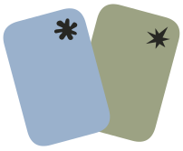
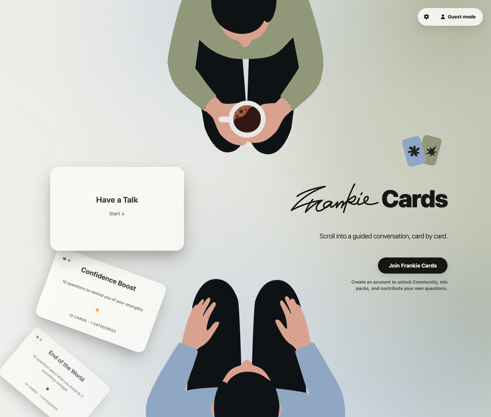

<h1 align="center"><picture><source media="(prefers-color-scheme: dark)" srcset=".github/brand/icon-dark.svg"></picture><br>Frankie Cards</h1>

<p align="center"><b>Turn hard-to-start conversations into cards you can open together—for partners, friends, families, and people who have only just met.</b></p>

<p align="center"><a href="https://songhaifan.github.io/frankie-cards/">Introduction</a> · <a href="https://frank-cards.vercel.app">Open app</a> · <a href="docs/guide.en.md">Guide</a> · <a href="README.zh-CN.md">中文</a></p>

<p align="center"></p>

## What it does

- Choose a pack that guides a conversation from light to meaningful.
- Find the right energy with rounded Bouba and pointed Kiki questions.
- Filter and combine packs, or create questions directly on the cards.

## Run locally

Requires Node.js 20+ and npm.

```sh
npm ci
npm run dev
```

Open the Vite URL. Account and user-topic setup is documented in the [Supabase guide](supabase/README.md).

## Before you start

Built-in packs work without an account. Sign in to create private packs; public sharing requires review. Community work stays separate from official packs, and edits to published packs return to review.

## For developers

```sh
npm run build
```

See the [development notes](DEV-README.md) and [contribution guide](CONTRIBUTING_GUIDE.md).

[Project guide](docs/guide.en.md) · [Artwork](docs/readme/README.md)

---

<p align="center"><a href="https://songhaifan.github.io/frankie-brain/"></a> &nbsp; <a href="https://songhaifan.github.io/frankie-brain-ios/"></a> &nbsp; <a href="https://songhaifan.github.io/frankie-cards/"></a> &nbsp; <a href="https://songhaifan.github.io/frankie-dictionary/"></a> &nbsp; <a href="https://songhaifan.github.io/frankie-generative-art/"></a> &nbsp; <a href="https://songhaifan.github.io/frankie-goal/"></a> &nbsp; <a href="https://songhaifan.github.io/frankie-guitar/"></a> &nbsp; <a href="https://songhaifan.github.io/frankie-list/"></a> &nbsp; <a href="https://songhaifan.github.io/frankie-mbti/"></a> &nbsp; <a href="https://songhaifan.github.io/frankie-onitama/"></a> &nbsp; <a href="https://songhaifan.github.io/frankie-poker/"></a> &nbsp; <a href="https://songhaifan.github.io/frankie-stocks/"></a> &nbsp; <a href="https://songhaifan.github.io/frankie-tarot/"></a> &nbsp; <a href="https://songhaifan.github.io/frankie-tarot-api/"></a> &nbsp; <a href="https://songhaifan.github.io/frankie-werewolf/"></a></p>

<p align="center"><sub>Part of the Frankie series · Made by <a href="https://github.com/SonghaiFan">Songhai Fan</a></sub></p>

<p align="right"><picture><source media="(prefers-color-scheme: dark)" srcset=".github/brand/signature-dark.svg"></picture></p>
