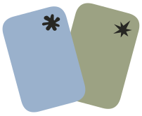
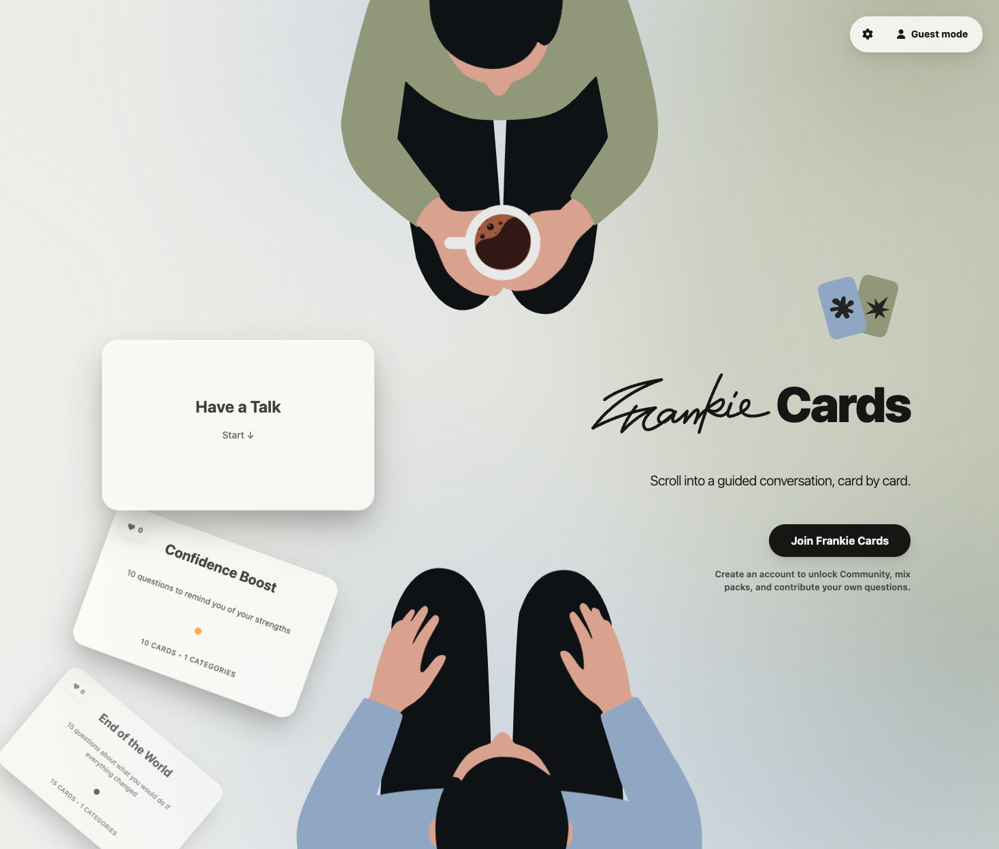

<h1 align="center"><picture><source media="(prefers-color-scheme: dark)" srcset=".github/brand/icon-dark.svg"></picture><br>Frankie Cards</h1>

<p align="center"><b>把难开口的话，变成可以一起翻开的卡片。为伴侣、朋友、家人，以及刚刚认识的人准备。</b></p>

<p align="center"><a href="https://songhaifan.github.io/frankie-cards/zh/">项目介绍</a> · <a href="https://frank-cards.vercel.app">打开应用</a> · <a href="docs/guide.en.md">使用指南</a> · <a href="README.md">English</a></p>

<p align="center"></p>

## 可以做什么

- 选一个对话包，让问题自然地从轻松走向深入。
- 用 Bouba 和 Kiki 两种问题能量，找到适合此刻的聊天方式。
- 筛选、组合卡包，或直接在真实卡片上创作自己的问题。

## 本地运行

需要 Node.js 20+ 与 npm。

```sh
npm ci
npm run dev
```

打开 Vite 输出的本地地址。账户与用户话题的配置见 [Supabase 说明](supabase/README.md)。

## 开始之前

内置卡包无需登录。登录后可以创建私人卡包；公开分享需要提交审核。社区作品与官方内容分开呈现，修改已发布卡包后会重新进入审核。

## 开发说明

```sh
npm run build
```

原生开发见 [开发说明](DEV-README.md)，参与协作前请阅读 [贡献指南](CONTRIBUTING_GUIDE.md)。

[项目指南](docs/guide.md) · [Banner 维护](docs/readme/README.md)

---

<p align="center"><a href="https://songhaifan.github.io/frankie-brain/"></a> &nbsp; <a href="https://songhaifan.github.io/frankie-brain-ios/"></a> &nbsp; <a href="https://songhaifan.github.io/frankie-cards/"></a> &nbsp; <a href="https://songhaifan.github.io/frankie-dictionary/"></a> &nbsp; <a href="https://songhaifan.github.io/frankie-generative-art/"></a> &nbsp; <a href="https://songhaifan.github.io/frankie-goal/"></a> &nbsp; <a href="https://songhaifan.github.io/frankie-guitar/"></a> &nbsp; <a href="https://songhaifan.github.io/frankie-list/"></a> &nbsp; <a href="https://songhaifan.github.io/frankie-mbti/"></a> &nbsp; <a href="https://songhaifan.github.io/frankie-onitama/"></a> &nbsp; <a href="https://songhaifan.github.io/frankie-poker/"></a> &nbsp; <a href="https://songhaifan.github.io/frankie-stocks/"></a> &nbsp; <a href="https://songhaifan.github.io/frankie-tarot/"></a> &nbsp; <a href="https://songhaifan.github.io/frankie-tarot-api/"></a> &nbsp; <a href="https://songhaifan.github.io/frankie-werewolf/"></a></p>

<p align="center"><sub>Frankie 系列 · 制作：<a href="https://github.com/SonghaiFan">Songhai Fan</a></sub></p>

<p align="right"><picture><source media="(prefers-color-scheme: dark)" srcset=".github/brand/signature-dark.svg"></picture></p>
