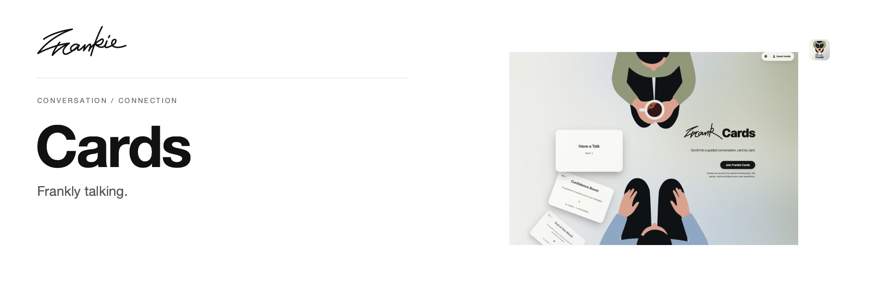

# Frankie Cards

[English](README.md) · [简体中文](README.zh-CN.md)

把难开口的话，变成可以一起翻开的卡片。为伴侣、朋友、家人，以及刚刚认识的人准备。

[在线使用](https://frank-cards.vercel.app/) · [项目指南](docs/guide.md) · [本地运行](#本地运行)

## 可以做什么

- 选一个对话包，让问题自然地从轻松走向深入。
- 用 Bouba 和 Kiki 两种问题能量，找到适合此刻的聊天方式。
- 筛选、组合卡包，或直接在真实卡片上创作自己的问题。

## 本地运行

需要 Node.js 20+ 与 npm。

```sh
npm ci
npm run dev
```

打开 Vite 输出的本地地址。账户与用户话题的配置见 [Supabase 说明](supabase/README.md)。

## 开始之前

内置卡包无需登录。登录后可以创建私人卡包；公开分享需要提交审核。社区作品与官方内容分开呈现，修改已发布卡包后会重新进入审核。

## 开发说明

```sh
npm run build
```

原生开发见 [开发说明](DEV-README.md)，参与协作前请阅读 [贡献指南](CONTRIBUTING_GUIDE.md)。

[项目指南](docs/guide.md) · [Banner 维护](docs/readme/README.md)

---

由 [Songhai Fan](https://github.com/SonghaiFan) 制作 · Frankie 系列项目 · [许可证](LICENSE)
