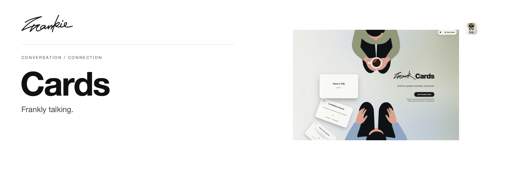

# Frankie Cards

Turn hard-to-start conversations into cards you can open together—for partners, friends, families, and people who have only just met.

[Use online](https://frank-cards.vercel.app/) · [中文](../README.md) · [Guide](../docs/guide.en.md) · [Run locally](#run-locally)

## What it does

- Choose a pack that guides a conversation from light to meaningful.
- Find the right energy with rounded Bouba and pointed Kiki questions.
- Filter and combine packs, or create questions directly on the cards.

## Run locally

Requires Node.js 20+ and npm.

```sh
npm ci
npm run dev
```

Open the Vite URL. Account and user-topic setup is documented in the [Supabase guide](../supabase/README.md).

## Before you start

Built-in packs work without an account. Sign in to create private packs; public sharing requires review. Community work stays separate from official packs, and edits to published packs return to review.

## For developers

```sh
npm run build
```

See the [development notes](../DEV-README.md) and [contribution guide](../CONTRIBUTING_GUIDE.md).

[Project guide](../docs/guide.en.md) · [Artwork](../docs/readme/README.md)

---

Made by [Songhai Fan](https://github.com/SonghaiFan) · A Frankie project · [License](../LICENSE)
